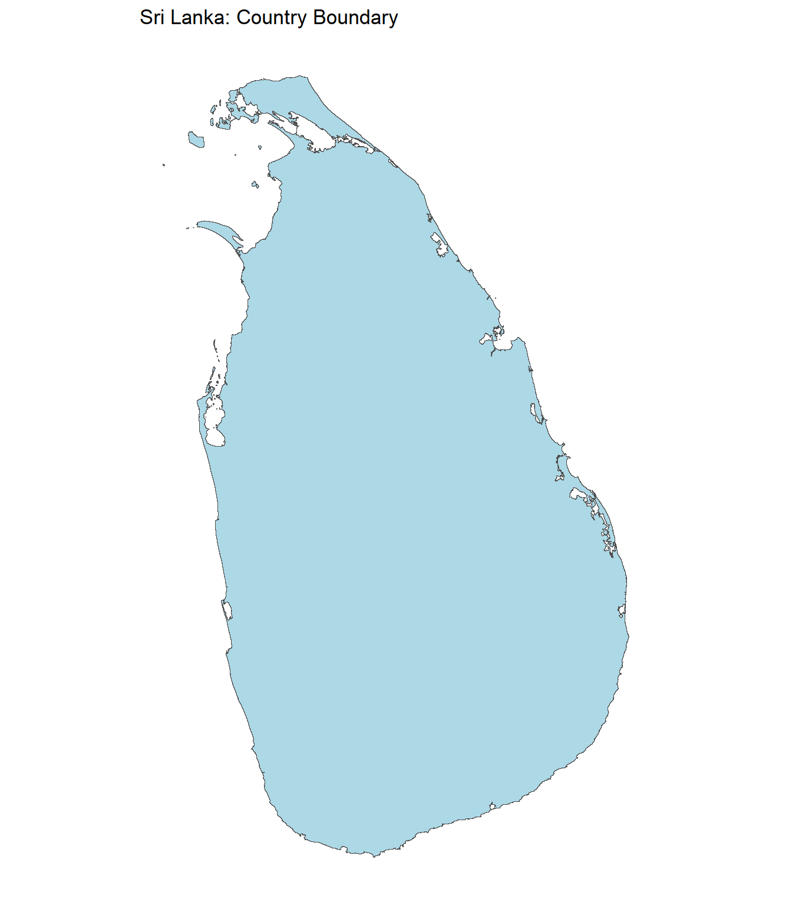
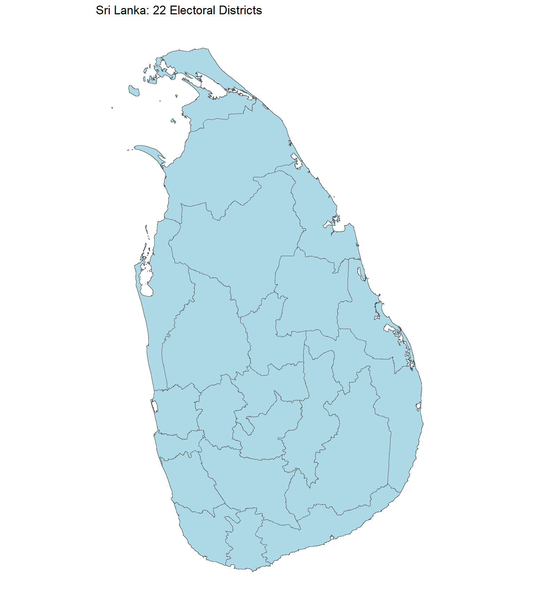
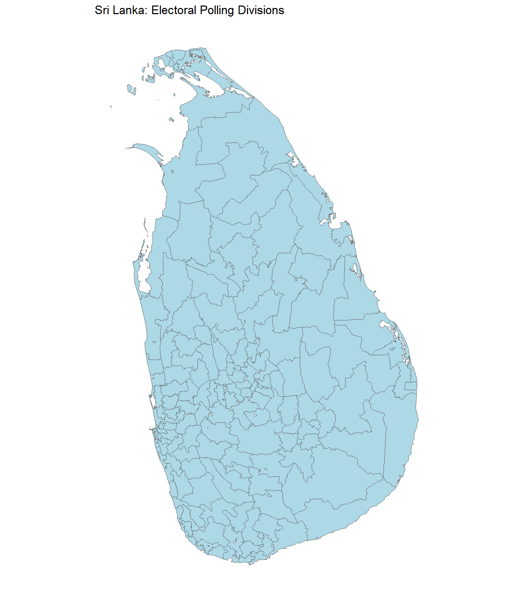
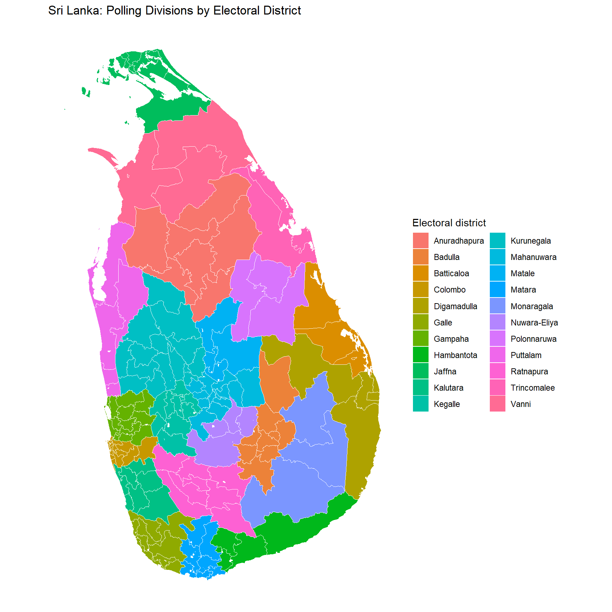
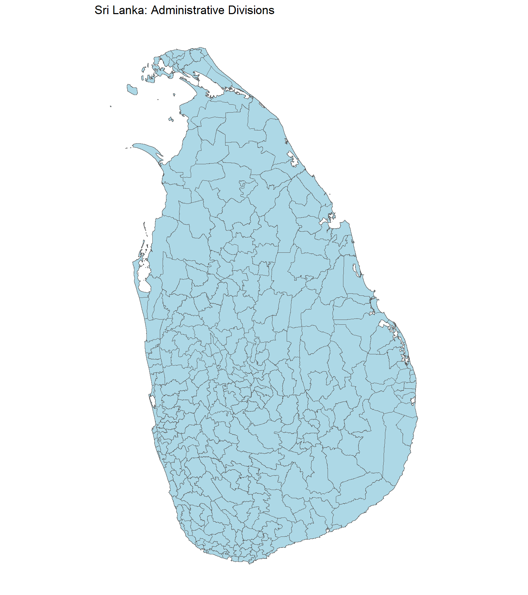

<!-- README.md is generated from README.Rmd. Please edit that file -->

# SLspatial 

<!-- badges: start -->

[](https://cran.r-project.org/package=SLspatial)
[](https://cran.r-project.org/package=SLspatial)
[](https://cran.r-project.org/package=SLspatial)
[](https://www.repostatus.org/#active)
[](https://lifecycle.r-lib.org/articles/stages.html#stable)
[](https://github.com/Amalan-ConStat/SLspatial/issues)
[](https://github.com/Amalan-ConStat/SLspatial)
[](https://lbesson.mit-license.org/)
[](https://app.codecov.io/gh/Amalan-ConStat/SLspatial)
<!-- badges: end -->

**SLspatial** provides spatial boundary datasets for Sri Lanka as simple
features (`sf`) objects. The package supports mapping, spatial analysis,
and integration of administrative and electoral geographic data. It
includes the country boundary, administrative districts, electoral
districts, electoral polling divisions, and administrative divisions.
The datasets support analysis at multiple geographic levels while
distinguishing administrative from electoral geography.

## Installation

Install the development version from GitHub:

``` r
# install.packages("remotes")
remotes::install_github("Amalan-ConStat/SLspatial")
```

## Available datasets

| Dataset | Features | Coverage | Key attributes |
|:---|---:|:---|:---|
| `SLBoundary` | 1 | Sri Lanka country boundary | `Country`, `ISO2`, `ISO3` |
| `SLAdministrativeDistricts` | 25 | Administrative districts | `SourceID`, `SourceName`, `District` |
| `SLElectoralDistricts` | 22 | Electoral districts | `District` |
| `SLElectorate` | 160 | Electoral polling divisions across 22 electoral districts | `ElecCode`, `District`, `Electorate`, `OrigName` |
| `SLAdminDivisions` | 323 | Administrative divisions across 25 administrative districts | `DistCode`, `District`, `EDistrict`, `DivCode`, `Division` |

All five datasets are `sf` objects with a `geometry` column. Counts
reflect the source boundary versions used in the package and should not
be interpreted as a statement about current official administrative
boundaries.

### `SLBoundary`

A single-feature country boundary, with country name and ISO two- and
three-letter codes. The geometry is a `MULTIPOLYGON` in WGS84
(EPSG:4326).

### `SLAdministrativeDistricts`

The 25 administrative district polygons. `SourceID` and `SourceName`
preserve identifiers and names from the source; `District` uses
election-aligned labels for selected districts (such as `Digamadulla`
for Ampara). **The geometry remains administrative:** Kilinochchi and
Jaffna, and the three administrative districts associated with Vanni,
remain separate features.

### `SLElectoralDistricts`

The 22 electoral district polygons, derived from
`SLAdministrativeDistricts`. Jaffna and Kilinochchi are combined into
the Jaffna electoral district; Mannar, Mullaitivu, and Vavuniya are
combined into Vanni. The remaining districts retain their administrative
boundaries. This is a **derived layer**, not an independently sourced
official electoral-boundary file.

### `SLElectorate`

The 160 electorate (polling division) polygons, with `ElecCode`,
`District`, `Electorate`, and `OrigName`. Names were harmonised with the
2024 presidential election data where possible. Three names were
manually assigned rather than confirmed through an exact election-data
match.

### `SLAdminDivisions`

The 323 administrative division polygons, with `DistCode`, `District`,
`EDistrict`, `DivCode`, and `Division`. `District` refers to the
administrative district; `EDistrict` is the corresponding electoral
district label, allowing aggregation or grouping by either geography.

**Administrative districts and electoral districts are not
interchangeable.** Use `SLElectoralDistricts` for electoral district
geometry and `SLAdministrativeDistricts` for administrative district
geometry. In particular, avoid interpreting the election-aligned
`District` labels in `SLAdministrativeDistricts` as meaning that the
polygons themselves have been merged.

## Getting started

``` r
library(SLspatial)
library(sf)
library(dplyr)
library(ggplot2)

# Inspect the datasets
lapply(
  list(SLBoundary = SLBoundary,
       SLAdministrativeDistricts = SLAdministrativeDistricts,
       SLElectoralDistricts = SLElectoralDistricts,
       SLElectorate = SLElectorate,
       SLAdminDivisions = SLAdminDivisions),
  nrow
)
#> $SLBoundary
#> [1] 1
#> 
#> $SLAdministrativeDistricts
#> [1] 25
#> 
#> $SLElectoralDistricts
#> [1] 22
#> 
#> $SLElectorate
#> [1] 160
#> 
#> $SLAdminDivisions
#> [1] 323

head(st_drop_geometry(SLElectorate))
#>   ElecCode    District   Electorate    OrigName
#> 1   EC-21A   Ratnapura  Eheliyagoda Eheliyagoda
#> 2   EC-13C Digamadulla     Kalmunai    Kalmunai
#> 3   EC-20C  Monaragala    Wellawaya   Wellawaya
#> 4   EC-12C  Batticaloa   Paddiruppu  Paddiruppu
#> 5   EC-13B Digamadulla Sammanthurai Samanthurai
#> 6   EC-18A Polonnaruwa    Minneriya   Minneriya
head(st_drop_geometry(SLAdminDivisions))
#>   DistCode District   EDistrict DivCode        Division
#> 1        1   Ampara Digamadulla       1  Addalachchenai
#> 2        1   Ampara Digamadulla       2    Akkaraipattu
#> 3        1   Ampara Digamadulla       3    Alayadiwembu
#> 4        1   Ampara Digamadulla       4          Ampara
#> 5        1   Ampara Digamadulla       5          Damana
#> 6        1   Ampara Digamadulla       6 Dehiattakandiya
```

## Mapping the country and district boundaries

Plot the national boundary:

``` r
ggplot(SLBoundary) +
  geom_sf(fill = "lightblue", colour = "grey30", linewidth = 0.3) +
  coord_sf(datum = NA) +
  theme_minimal() +
  labs(title = "Sri Lanka: Country Boundary")
```



Plot the 25 administrative districts:

``` r
ggplot(SLAdministrativeDistricts) +
  geom_sf(fill = "lightblue", colour = "grey30", linewidth = 0.3) +
  coord_sf(datum = NA) +
  theme_minimal() +
  labs(title = "Sri Lanka: 25 Administrative Districts")
```


Plot the 22 derived electoral districts:

``` r
ggplot(SLElectoralDistricts) +
  geom_sf(fill = "lightblue", colour = "grey30", linewidth = 0.3) +
  coord_sf(datum = NA) +
  theme_minimal() +
  labs(title = "Sri Lanka: 22 Electoral Districts")
```



## Mapping electoral polling divisions

``` r
ggplot(SLElectorate) +
  geom_sf(fill = "lightblue", colour = "grey35", linewidth = 0.15) +
  coord_sf(datum = NA) +
  theme_minimal() +
  labs(title = "Sri Lanka: Electoral Polling Divisions")
```



``` r
ggplot(SLElectorate) +
  geom_sf(aes(fill = District), colour = "white", linewidth = 0.12) +
  coord_sf(datum = NA) +
  theme_minimal() +
  theme(legend.position = "right") +
  labs(title = "Sri Lanka: Polling Divisions by Electoral District",
       fill = "Electoral district")
```



## Mapping administrative divisions

``` r
ggplot(SLAdminDivisions) +
  geom_sf(fill = "lightblue", colour = "grey35", linewidth = 0.12) +
  coord_sf(datum = NA) +
  theme_minimal() +
  labs(title = "Sri Lanka: Administrative Divisions")
```



## Exploring administrative and electoral districts

Count administrative divisions within each administrative district:

``` r
SLAdminDivisions |>
  st_drop_geometry() |>
  count(District, name = "AdministrativeDivisions") |>
  arrange(District)
#>        District AdministrativeDivisions
#> 1        Ampara                      19
#> 2  Anuradhapura                      22
#> 3       Badulla                      15
#> 4    Batticaloa                      12
#> 5       Colombo                      12
#> 6         Galle                      18
#> 7       Gampaha                      13
#> 8    Hambantota                      11
#> 9        Jaffna                      14
#> 10     Kalutara                      14
#> 11        Kandy                      20
#> 12      Kegalle                      11
#> 13  Kilinochchi                       4
#> 14   Kurunegala                      30
#> 15       Mannar                       5
#> 16       Matale                      11
#> 17       Matara                      16
#> 18   Moneragala                      11
#> 19   Mullaitivu                       5
#> 20 Nuwara Eliya                       5
#> 21  Polonnaruwa                       7
#> 22     Puttalam                      16
#> 23    Ratnapura                      17
#> 24  Trincomalee                      11
#> 25     Vavuniya                       4
```

Examine the correspondence between administrative and electoral
districts:

``` r
SLAdminDivisions |>
  st_drop_geometry() |>
  distinct(District, EDistrict) |>
  arrange(EDistrict, District)
#>        District    EDistrict
#> 1  Anuradhapura Anuradhapura
#> 2       Badulla      Badulla
#> 3    Batticaloa   Batticaloa
#> 4       Colombo      Colombo
#> 5        Ampara  Digamadulla
#> 6         Galle        Galle
#> 7       Gampaha      Gampaha
#> 8    Hambantota   Hambantota
#> 9        Jaffna       Jaffna
#> 10  Kilinochchi       Jaffna
#> 11     Kalutara     Kalutara
#> 12      Kegalle      Kegalle
#> 13   Kurunegala   Kurunegala
#> 14        Kandy   Mahanuwara
#> 15       Matale       Matale
#> 16       Matara       Matara
#> 17   Moneragala   Monaragala
#> 18 Nuwara Eliya Nuwara-Eliya
#> 19  Polonnaruwa  Polonnaruwa
#> 20     Puttalam     Puttalam
#> 21    Ratnapura    Ratnapura
#> 22  Trincomalee  Trincomalee
#> 23       Mannar        Vanni
#> 24   Mullaitivu        Vanni
#> 25     Vavuniya        Vanni
```

Count administrative divisions within each electoral district:

``` r
SLAdminDivisions |>
  st_drop_geometry() |>
  count(EDistrict, name = "AdministrativeDivisions") |>
  arrange(EDistrict)
#>       EDistrict AdministrativeDivisions
#> 1  Anuradhapura                      22
#> 2       Badulla                      15
#> 3    Batticaloa                      12
#> 4       Colombo                      12
#> 5   Digamadulla                      19
#> 6         Galle                      18
#> 7       Gampaha                      13
#> 8    Hambantota                      11
#> 9        Jaffna                      18
#> 10     Kalutara                      14
#> 11      Kegalle                      11
#> 12   Kurunegala                      30
#> 13   Mahanuwara                      20
#> 14       Matale                      11
#> 15       Matara                      16
#> 16   Monaragala                      11
#> 17 Nuwara-Eliya                       5
#> 18  Polonnaruwa                       7
#> 19     Puttalam                      16
#> 20    Ratnapura                      17
#> 21  Trincomalee                      11
#> 22        Vanni                      14
```

## Coordinate reference systems and spatial operations

The datasets retain their source geometries and coordinate reference
systems. Check the CRS before combining layers or calculating distances
and areas. Transform both layers to an appropriate common CRS when
performing spatial operations.

``` r
st_crs(SLBoundary)
#> Coordinate Reference System:
#>   User input: WGS 84 
#>   wkt:
#> GEOGCRS["WGS 84",
#>     DATUM["World Geodetic System 1984",
#>         ELLIPSOID["WGS 84",6378137,298.257223563,
#>             LENGTHUNIT["metre",1]]],
#>     PRIMEM["Greenwich",0,
#>         ANGLEUNIT["degree",0.0174532925199433]],
#>     CS[ellipsoidal,2],
#>         AXIS["latitude",north,
#>             ORDER[1],
#>             ANGLEUNIT["degree",0.0174532925199433]],
#>         AXIS["longitude",east,
#>             ORDER[2],
#>             ANGLEUNIT["degree",0.0174532925199433]],
#>     ID["EPSG",4326]]
st_crs(SLAdministrativeDistricts)
#> Coordinate Reference System:
#>   User input: WGS 84 
#>   wkt:
#> GEOGCRS["WGS 84",
#>     DATUM["World Geodetic System 1984",
#>         ELLIPSOID["WGS 84",6378137,298.257223563,
#>             LENGTHUNIT["metre",1]]],
#>     PRIMEM["Greenwich",0,
#>         ANGLEUNIT["degree",0.0174532925199433]],
#>     CS[ellipsoidal,2],
#>         AXIS["latitude",north,
#>             ORDER[1],
#>             ANGLEUNIT["degree",0.0174532925199433]],
#>         AXIS["longitude",east,
#>             ORDER[2],
#>             ANGLEUNIT["degree",0.0174532925199433]],
#>     ID["EPSG",4326]]
st_crs(SLElectoralDistricts)
#> Coordinate Reference System:
#>   User input: WGS 84 
#>   wkt:
#> GEOGCRS["WGS 84",
#>     DATUM["World Geodetic System 1984",
#>         ELLIPSOID["WGS 84",6378137,298.257223563,
#>             LENGTHUNIT["metre",1]]],
#>     PRIMEM["Greenwich",0,
#>         ANGLEUNIT["degree",0.0174532925199433]],
#>     CS[ellipsoidal,2],
#>         AXIS["latitude",north,
#>             ORDER[1],
#>             ANGLEUNIT["degree",0.0174532925199433]],
#>         AXIS["longitude",east,
#>             ORDER[2],
#>             ANGLEUNIT["degree",0.0174532925199433]],
#>     ID["EPSG",4326]]
st_crs(SLElectorate)
#> Coordinate Reference System:
#>   User input: EPSG:4326 
#>   wkt:
#> GEOGCRS["WGS 84",
#>     ENSEMBLE["World Geodetic System 1984 ensemble",
#>         MEMBER["World Geodetic System 1984 (Transit)"],
#>         MEMBER["World Geodetic System 1984 (G730)"],
#>         MEMBER["World Geodetic System 1984 (G873)"],
#>         MEMBER["World Geodetic System 1984 (G1150)"],
#>         MEMBER["World Geodetic System 1984 (G1674)"],
#>         MEMBER["World Geodetic System 1984 (G1762)"],
#>         MEMBER["World Geodetic System 1984 (G2139)"],
#>         MEMBER["World Geodetic System 1984 (G2296)"],
#>         ELLIPSOID["WGS 84",6378137,298.257223563,
#>             LENGTHUNIT["metre",1]],
#>         ENSEMBLEACCURACY[2.0]],
#>     PRIMEM["Greenwich",0,
#>         ANGLEUNIT["degree",0.0174532925199433]],
#>     CS[ellipsoidal,2],
#>         AXIS["geodetic latitude (Lat)",north,
#>             ORDER[1],
#>             ANGLEUNIT["degree",0.0174532925199433]],
#>         AXIS["geodetic longitude (Lon)",east,
#>             ORDER[2],
#>             ANGLEUNIT["degree",0.0174532925199433]],
#>     USAGE[
#>         SCOPE["Horizontal component of 3D system."],
#>         AREA["World."],
#>         BBOX[-90,-180,90,180]],
#>     ID["EPSG",4326]]
st_crs(SLAdminDivisions)
#> Coordinate Reference System:
#>   User input: WGS 84 
#>   wkt:
#> GEOGCRS["WGS 84",
#>     DATUM["World Geodetic System 1984",
#>         ELLIPSOID["WGS 84",6378137,298.257223563,
#>             LENGTHUNIT["metre",1]]],
#>     PRIMEM["Greenwich",0,
#>         ANGLEUNIT["degree",0.0174532925199433]],
#>     CS[ellipsoidal,2],
#>         AXIS["latitude",north,
#>             ORDER[1],
#>             ANGLEUNIT["degree",0.0174532925199433]],
#>         AXIS["longitude",east,
#>             ORDER[2],
#>             ANGLEUNIT["degree",0.0174532925199433]],
#>     ID["EPSG",4326]]
st_bbox(SLBoundary)
#>      xmin      ymin      xmax      ymax 
#> 79.521805  5.918472 81.878754  9.835971
```

## Data sources and limitations

- **Electoral polling division boundaries:**
  [nuuuwan/sl-topojson](https://github.com/nuuuwan/sl-topojson), using
  the polling division TopoJSON dated 20 November 2020.
- **Country and administrative district boundaries:** Source
  administrative shapefiles used to prepare `SLBoundary` and
  `SLAdministrativeDistricts`; check the associated source metadata for
  version and licence.
- **Electoral district boundaries:** Derived from
  `SLAdministrativeDistricts` by merging administrative polygons into 22
  electoral districts.
- **Administrative division boundaries:** [GADM](https://gadm.org/),
  from the source `LKA_adm2.shp` shapefile.
- **Electorate naming reference:** The 2024 presidential election
  dataset from
  [`SLPresElection`](https://github.com/Amalan-ConStat/SLPresElection).

Spatial boundaries and administrative arrangements can change over time.
The included geometries should not be assumed to reproduce historical
electoral or administrative boundaries for every election year. Users
should verify source licensing, attribution requirements, and
suitability for their intended use.

## Documentation and contributing

For dataset descriptions, use `?SLBoundary`,
`?SLAdministrativeDistricts`, `?SLElectoralDistricts`, `?SLElectorate`,
and `?SLAdminDivisions` after loading the package. Issues and
suggestions can be submitted through the [GitHub issue
tracker](https://github.com/Amalan-ConStat/SLspatial/issues).

#### Thank You

[](https://www.linkedin.com/in/amalan-mahendran-72b86b37/)
[](https://www.researchgate.net/profile/Amalan_Mahendran)
